# Microsoft Entra ID – Identity & Access Management Lab

## Project Overview

This hands-on lab demonstrates foundational Identity and Access Management (IAM) tasks in Microsoft Entra ID. The project focuses on user lifecycle administration, group-based access, enterprise application assignment, Conditional Access, MFA configuration, sign-in monitoring, and basic identity troubleshooting.

> **Lab note:** Maya Johnson and the Finance Employees group are fictional test identities created only for this lab. Screenshots were sanitized/redacted for privacy.

## Objectives

- Create and manage test user accounts in Microsoft Entra ID
- Create a security group and manage group membership
- Assign group-based access to an enterprise application
- Configure a Conditional Access policy requiring MFA
- Keep the Conditional Access policy in **Report-only** mode for safe testing
- Review sign-in activity and filter logs by user/date
- Troubleshoot a failed user sign-in
- Reset a test-user password and validate successful access in a private browser session

## Environment & Tools

- Microsoft Entra ID
- Microsoft Entra admin center
- Microsoft 365 / My Account
- Conditional Access
- Enterprise Applications
- Sign-in Logs
- Private/InPrivate browser session
 ## Lab Evidence

### 1. Test Users Created
Created and managed test users in Microsoft Entra ID, including Maya Johnson.

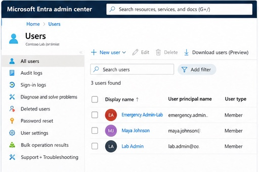

### 2. Security Group Created
Created a security group named **Finance Employees**.

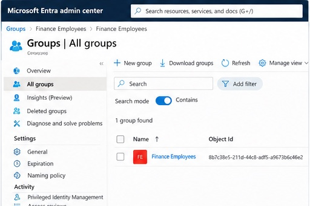

### 3. Group Membership
Added Maya Johnson to the **Finance Employees** security group.

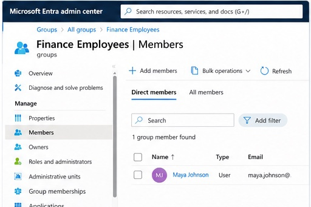

### 4. Enterprise Application Created
Created the **Finance Portal - Lab** enterprise application.

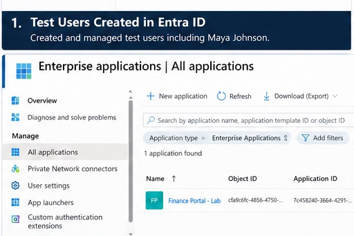

### 5. App Access Assignment
Assigned the **Finance Employees** group to the Finance Portal application.

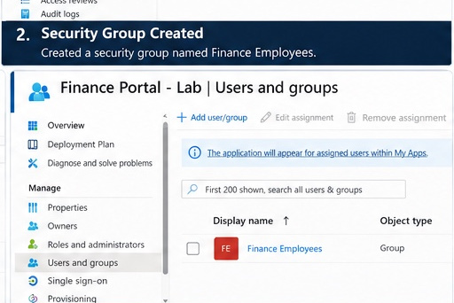

### 6. Conditional Access Policy
Created a Conditional Access policy requiring MFA and kept it in **Report-only** mode for safe testing.

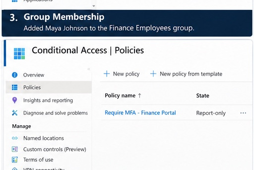

### 7. Sign-In Logs
Reviewed Maya Johnson's sign-in activity and filtered the sign-in logs to investigate authentication attempts.

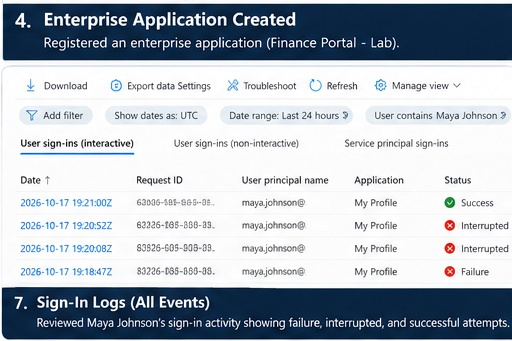

### 8. Successful Sign-In Details
Reviewed the successful authentication event after resolving the sign-in issue.

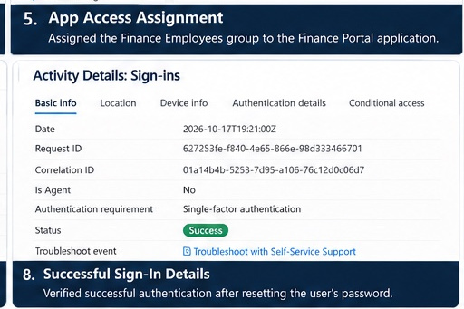

### 9. User Sign-In Verification
Verified the test user's account access and security information.

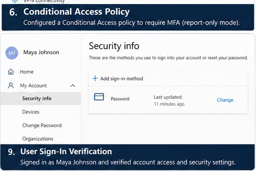

### 10. Conditional Access Policy Overview
Reviewed the Conditional Access policy configuration, including the Report-only state, targeted group, resource, and MFA requirement.

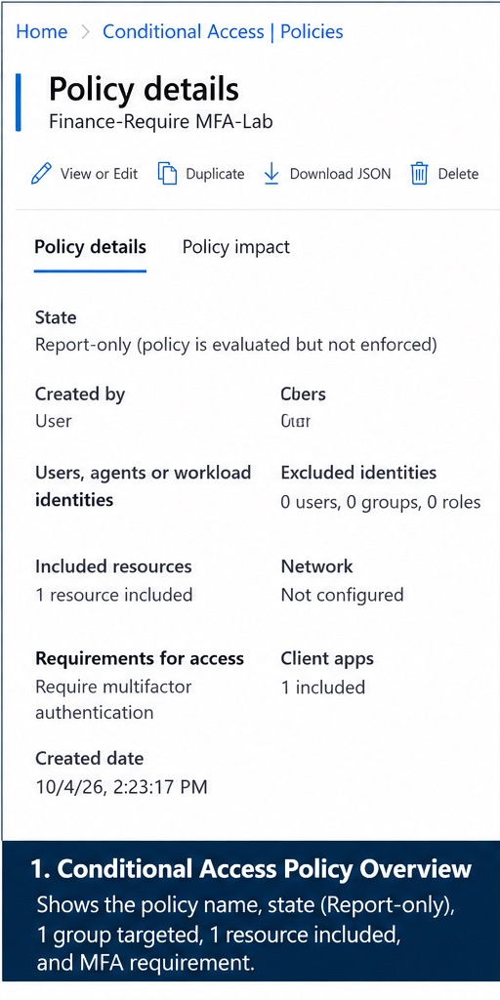

### 11. Policy Assignment
Verified that the Conditional Access policy was assigned to the **Finance Employees** group.

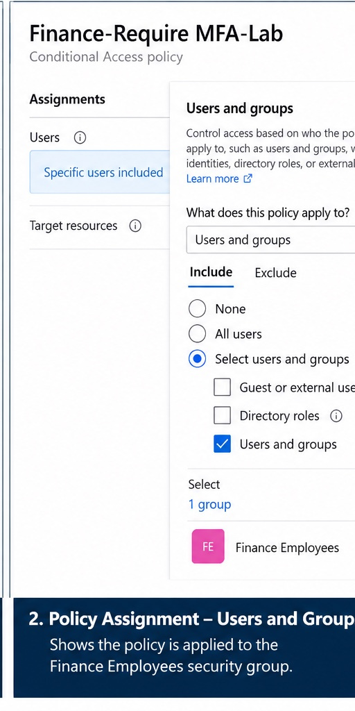

### 12. Grant Access – MFA Requirement
Verified the access control was configured to grant access while requiring multifactor authentication.

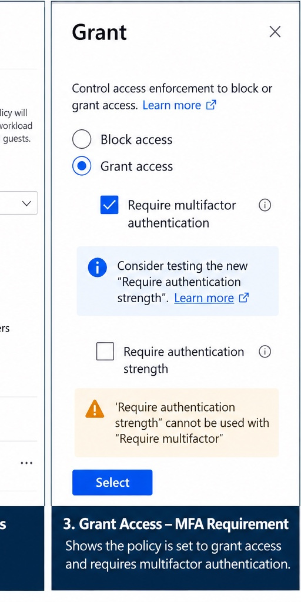

### 13. Failed Sign-In Investigation
Investigated a failed sign-in event using Microsoft Entra sign-in logs.

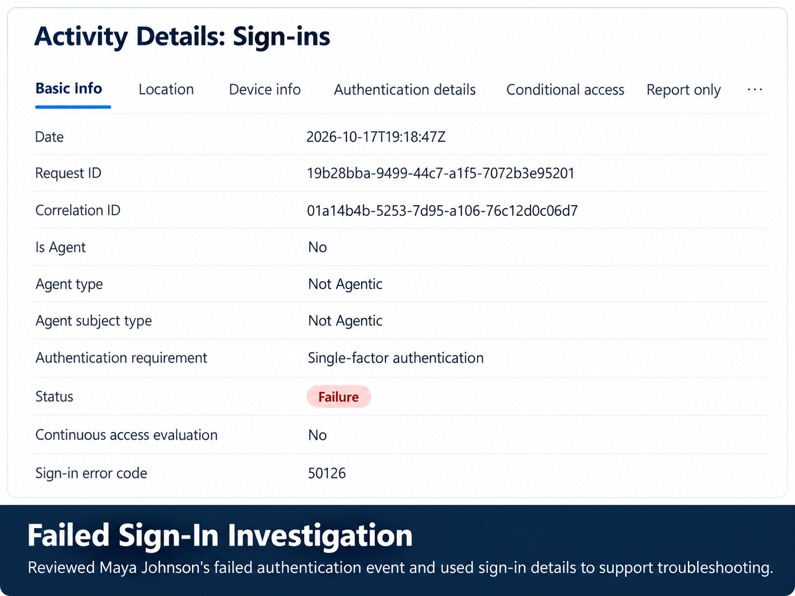

### 14. Successful Sign-In Verification
Reset the test user's password, signed in again, and verified the authentication succeeded.

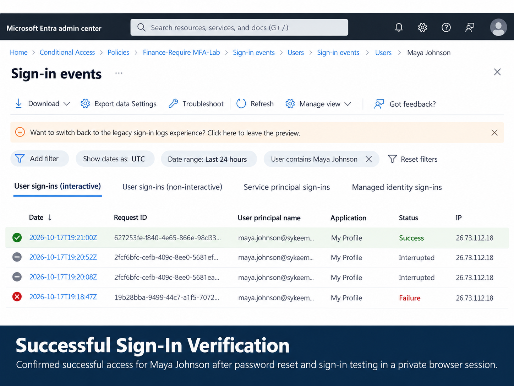

### 15. Private Browser User Verification
Used a private browser session to sign in as the test user and confirm access after the password reset.

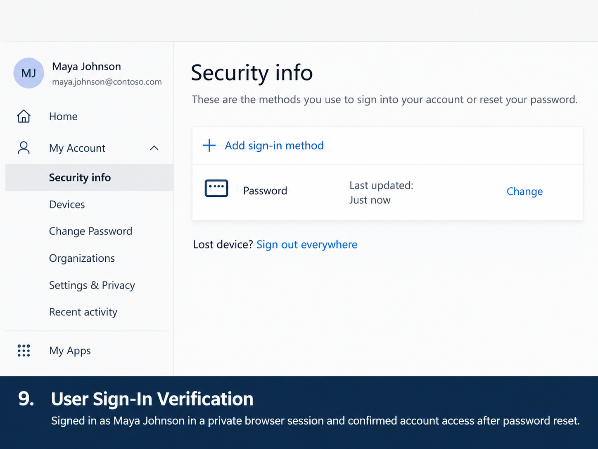
